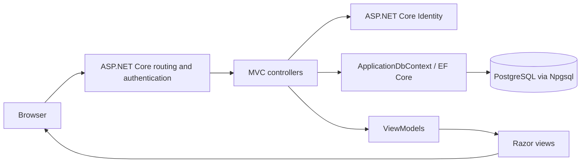

# Everkeep Architecture

## Request and data flow

Everkeep is a server-rendered ASP.NET Core MVC application. The React and TypeScript folders are separate learning exercises and are not part of the MVC request path.

## Main components

| Component | Responsibility |
| --- | --- |
| `Program.cs` | Registers MVC, Identity, the EF Core context and the HTTP middleware pipeline. |
| `Controllers/` | Handles profile, connection, messaging, journal, memory and dashboard requests. |
| `Models/` | Defines users, connections, messages and journal entries. |
| `ViewModels/` | Shapes controller data for Razor views. |
| `Data/ApplicationDbContext.cs` | Extends the Identity EF context and configures entity relationships. |
| `Migrations/` | Stores the active PostgreSQL schema history. Legacy SQL Server migrations are excluded from the active migration assembly. |
| `Areas/Identity/` | Contains the ASP.NET Core Identity account and account-management pages. |
| `Views/` and `wwwroot/` | Render HTML and provide the application's CSS, JavaScript and images. |

## Authentication and access boundaries

ASP.NET Core Identity authenticates users. Profile, connection, messaging, journal and memory controllers require an authenticated user. Controllers use the signed-in user's ID to scope data and enforce ownership or relationship rules.

- A profile's name, bio and emotional status are visible to its owner and accepted connections. Email is visible only to the owner.
- A journal entry belongs to one user. New entries default to private; only the owner can edit, change visibility or importance, or delete it. Public entries are visible to accepted connections.
- Messages can be sent and read only between accepted connections. Only participants can favorite a message; only its sender can delete it.
- Connection invitations can be accepted or rejected by the recipient. Only a participant can remove a connection.
- Memory queries are scoped to the signed-in user and include that user's received favorite messages and important journal entries.

These rules are documented in [the privacy and data policy](privacy-and-data-policy.md) and have controller-level tests. Authentication filters and antiforgery middleware are also part of the production request pipeline; direct controller tests do not exercise browser antiforgery tokens.

## Persistence and migrations

The application uses Entity Framework Core with the Npgsql provider and PostgreSQL. The connection string is loaded from configuration; local development credentials belong in .NET User Secrets. Schema changes are stored as EF Core migrations. The old SQL Server migrations remain under `Migrations/SqlServerLegacy` and are not used to convert existing SQL Server data.

Automated tests use a temporary in-memory SQLite database. They do not validate PostgreSQL-specific migrations or require a running PostgreSQL server. The setup and migration commands are in the [README](../README.md) and the [local PostgreSQL guide](postgresql-local-setup.md).

## Current boundaries

- The `Timeline` controller, view model and view are present but excluded from the current application build.
- There is no separate application-services layer; controllers currently coordinate Identity, EF Core and view models.
- The React and TypeScript exercises are standalone packages and do not call the Everkeep MVC application.
- PostgreSQL deployment, browser end-to-end tests and a production hosting configuration are outside the current setup.
